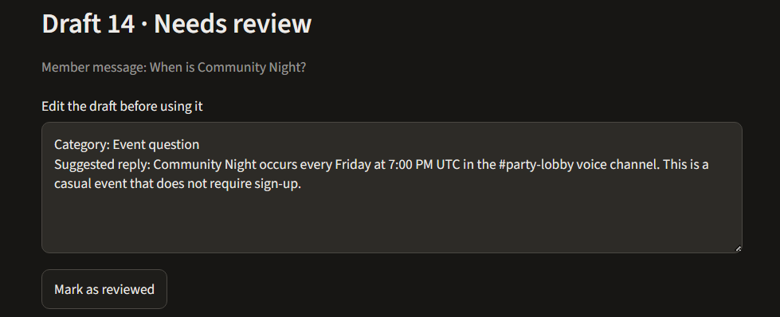

# AI Community Assistant

A beginner project for learning Python and AI while building a portfolio piece for community management.

This version runs an open model on your own computer with Ollama and shows it in a small Streamlit dashboard. It takes a fictional gaming community message, suggests a category, and drafts a short reply. A human moderator should review every draft before sending it.



*Example of the assistant using the community guide to answer an event question.*

## Project overview

The goal is to help community moderators triage common questions and prepare consistent reply drafts while keeping people responsible for decisions. The model uses a fictional community guide, and the dashboard provides an editable review queue with local status tracking.

## Features

- Uses simple Python rules to label event, account, bug, and general messages.
- Uses an approved fixed reply for account-help messages; the local AI drafts replies for event, bug, and general messages.
- Drafts a helpful response using facts from `community_guide.md`.
- Runs locally with Ollama; no paid API key is needed.
- Lets a moderator edit, review, and reopen drafts.
- Saves the review queue in a local file that is excluded from Git by `.gitignore`.
- Does not connect to Discord or send messages.

## Set up the local AI

1. Install Ollama from the [official Windows download page](https://ollama.com/download/windows), then open the Ollama app.
2. In the VS Code terminal, download and start the small Qwen model:

   ```text
   ollama run qwen3:1.7b
   ```

   The first run downloads the model (about 1.4 GB). When its chat prompt appears, type `/bye` and press Enter to return to PowerShell.

3. Install the Python libraries for the local AI connection and dashboard:

   ```text
   python -m pip install -r requirements.txt
   ```

4. Start the dashboard:

   ```text
   python -m streamlit run app.py
   ```

5. A browser tab will open. Enter a made-up example such as `My game freezes whenever I launch it`, then click **Generate draft**.

The model download needs an internet connection and disk space. After downloading, the program sends messages to Ollama running on this computer; it does not need a paid API account or API key. Ollama says local model speed depends on your computer's hardware, and larger models can be slower without a strong graphics card. See the [Ollama quickstart](https://docs.ollama.com/quickstart) for more about local models.

## What the AI code does

- The `system` message gives the AI its role and safety boundaries.
- The `user` message contains the example from the community member.
- `classify_message(...)` assigns the category with clear keyword rules; the AI focuses on writing the reply.
- `chat(...)` sends event, bug, and general messages to the local Ollama model. Account-help messages use an approved reply in the app code.
- `response.message.content` is the draft displayed in the dashboard.
- The assistant reads `community_guide.md` and uses those fictional facts when drafting answers. Update that guide when you want to change the community's events or support information.

## What the dashboard adds

- Streamlit turns the Python script into a local web page.
- The message box collects an example message, and the button starts the AI request.
- Drafts appear in a review queue. A moderator can revise each draft, mark it reviewed, or reopen it.
- The review queue is saved locally in `drafts.json`, so it remains after closing the dashboard. The `.gitignore` file keeps this local history out of GitHub by default.
- The app does not connect to Discord or send messages.

Use fictional examples while learning. Avoid using real member messages or personal information in this prototype.

## Manual checks

See [manual_test_checklist.md](manual_test_checklist.md) for example messages, expected behavior, and dashboard checks. AI wording varies, so review whether the meaning and safety rules are followed rather than expecting identical text each time.
